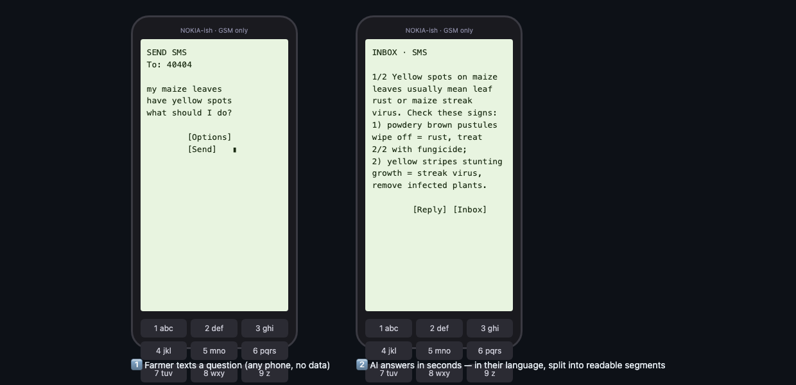
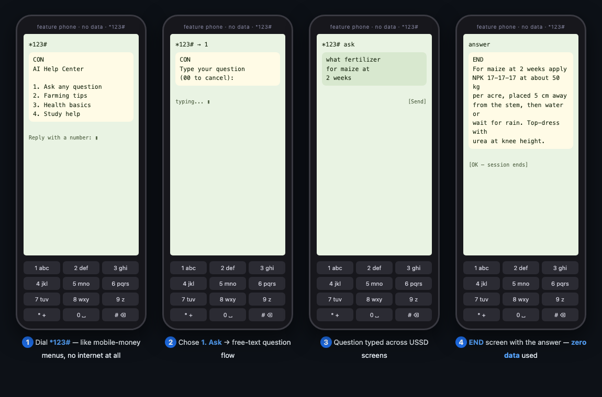
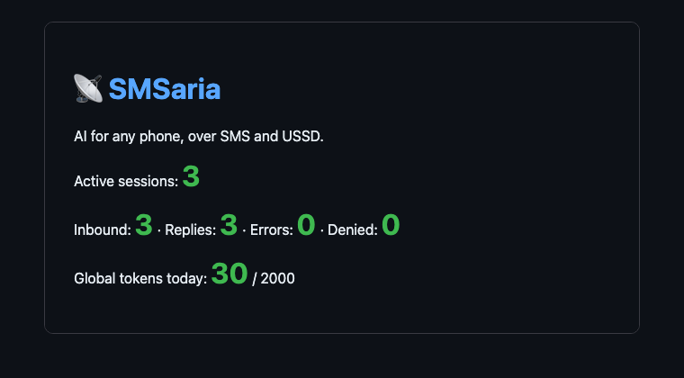

# 📡 SMSaria

**AI for any phone — the open-source gateway that turns a phone number into an AI service.**



2.6 billion people still use basic phones with no data plan. Across Africa,
South Asia, and rural America, SMS works where the internet doesn't — but the
AI services reaching those users today are **closed, proprietary platforms**.
The operator owns the number, sees every question, and charges per message.

SMSaria is the missing open-source piece: a **zero-dependency Python gateway**
that any NGO, school, clinic, or developer can run to give their community AI
over **SMS and USSD** — on a $5 VPS, a Raspberry Pi, or **fully offline** with
llama.cpp. Your number. Your server. Your rules.

```
$ python -m smsaria.server
SMSaria listening on :8080 — AI for any phone.
```

## ✨ How people use it

### SMS — works on every phone that can text

A farmer texts *"my maize leaves have yellow spots, what should I do?"* — no
smartphone, no app, no data bundle, just 2G signal:

- SMSaria receives the message via your gateway (Twilio, Africa's Talking, or
  a $15 USB GSM modem — **zero per-message API fees**)
- The AI answer comes back **in the farmer's language**, compressed and split
  into clean, readable segments that arrive in order
- The conversation has **memory**: "and for children?" or "how about beans?"
  works as a follow-up, for 10 minutes after the last message

### USSD — no typing skill needed, no internet at all



Dial `*123#` and get a **numbered menu** — the same interface as checking your
mobile-money balance, so even first-time phone users already know how it works:

```
AI Help Center

1. Ask any question
2. Farming tips
3. Health basics
4. Study help
```

Menus are plain JSON you can edit. Question flows collect the answer across
USSD screens and reply instantly. **USSD works on every handset ever made.**

### Live dashboard



`http://your-host:8080/` shows active sessions, message counts, errors, and
token usage against your daily cap — so you know exactly what the service
costs while it runs.

---

## 🚀 Quick start (5 minutes)

### Step 1 — Get the code

```bash
git clone https://github.com/awaisdev5765/smsaria.git
cd smsaria
```

Requirements: **Python 3.9+**. That's it — zero `pip install`s.

### Step 2 — Configure the AI provider

Any OpenAI-compatible endpoint works. The fastest free option is Groq:

1. Create a free API key at [console.groq.com](https://console.groq.com)
2. Set the environment:

```bash
export SMSARIA_PROVIDER_BASE="https://api.groq.com/openai/v1"
export SMSARIA_PROVIDER_KEY="gsk_your_key_here"
export SMSARIA_MODEL="llama-3.1-8b-instant"
```

Want **fully offline**? Run llama.cpp's `llama-server` on the same machine and
point `SMSARIA_PROVIDER_BASE` at `http://127.0.0.1:8080/v1`. SMSaria then
works with **no internet at all** — the phone network talks to you, the AI
answers locally.

### Step 3 — Run it

```bash
python -m smsaria.server        # listens on :8080
```

Test it locally without any gateway:

```bash
curl -X POST http://localhost:8080/sms/raw \
  -H "Content-Type: application/json" \
  -d '{"sender": "+254700000001", "text": "what is malaria?"}'
```

### Step 4 — Connect a real phone number

Pick **one** gateway:

| Gateway | Setup | Cost | Best for |
|---|---|---|---|
| **Africa's Talking** | Set inbound callback to `/sms/africastalking`, USSD callback to `/ussd/africastalking` | Pay per SMS | Africa (2G-first markets) |
| **Twilio** | Set inbound webhook to `/sms/twilio` | Pay per SMS | Everywhere else |
| **GSM modem** | `$15 USB dongle + SIM` running `gammu-smsd`, forward to `/sms/raw` | **Just the SIM plan** | Community deployments, no API fees |

Each provider's exact webhook settings are in
[docs/DEPLOY.md](docs/DEPLOY.md), including the systemd unit for a
always-on server.

### Step 5 — Text your number 🎉

Send anything. You'll get a reply in seconds. Set caps before opening it to
a community (see guardrails below).

---

## 🏗️ How it works

```
Feature phone ──SMS/USSD──▶ Phone network ──webhook──▶ SMSaria (:8080)
                                                            │
        ┌───────────────────────────────────────────────────┤
        │  adapter:     normalize Twilio/AT/raw webhook      │
        │  sessions:    per-number history, TTL, language    │
        │  budget:      per-sender + global daily caps       │
        │  provider:    any OpenAI-compatible /chat API      │
        │  fallback:    cached answers when provider is down │
        │  sms codec:   compress + split at word bounds      │
        └───────────────────────────────────────────────────┘
                                                            │
Reply segments ◀────────phone network◀──────────────────────┘
```

Every piece is a small, readable module:

```
smsaria/
├── server.py                  # stdlib HTTP server + pipeline glue
├── gateway/
│   ├── sms.py                 # GSM-7/UCS-2 codec: compress, split
│   └── sessions.py            # TTL conversation store
├── providers/
│   └── openai_compat.py       # chat provider + Budget guardrails
├── adapters/
│   └── webhooks.py            # Twilio / Africa's Talking / raw
└── ussd/
    └── engine.py              # menu-tree engine (CON/END screens)
```

## 🔧 Configuration reference

All configuration is environment variables — nothing to edit in code.

| Variable | Default | Meaning |
|---|---|---|
| `SMSARIA_PROVIDER_BASE` | Groq endpoint | Any OpenAI-compatible base URL |
| `SMSARIA_PROVIDER_KEY` | — | API key for the provider |
| `SMSARIA_MODEL` | `llama-3.1-8b-instant` | Model name |
| `SMSARIA_SYSTEM_PROMPT` | built-in | System prompt; use `{language_hint}` to auto-match the sender's language |
| `SMSARIA_PER_SENDER_DAILY` | `20` | Max tokens **per phone number per day** |
| `SMSARIA_GLOBAL_DAILY` | `2000` | Max tokens across **all** numbers per day |
| `SMSARIA_ADAPTERS` | `raw` | Comma list: `twilio,africastalking,raw` |
| `SMSARIA_AT_API_KEY` | — | Africa's Talking API key (if using AT) |
| `SMSARIA_AT_USERNAME` | — | Africa's Talking username |
| `SMSARIA_AT_SANDBOX` | `1` | `1` = AT sandbox host |
| `SMSARIA_PORT` | `8080` | HTTP listen port |

**Cost math example**: Groq's free tier + a GSM modem = **$0 running cost**
for a pilot serving a school or clinic. With Africa's Talking at ~$0.01/SMS,
a 100-message day costs about **$1/day** — plus zero API cost if you use a
free LLM tier.

## 🛡️ Guardrails (why they matter)

When you give a community AI access, one curious person can burn your whole
API budget. SMSaria enforces limits **before** the AI is called:

- **Per-sender daily cap** — one abusive or very active user hits their own
  limit, everyone else is unaffected, and they get a polite SMS telling them
  when to try again
- **Global daily cap** — the service degrades gracefully at capacity instead
  of surprising you with a provider bill
- **Max reply tokens** — every answer is bounded; long answers get split into
  readable segments rather than truncated mid-thought

Watch it all live at `/` — token usage against the daily cap updates on
every message.

## 🌍 Language support

SMSaria hints the model toward the sender's language using script detection
and keyword matching (Arabic/Urdu script, Devanagari, Swahili keywords), and
the model does the real translation. The person texts in *their* language;
the answer comes back in *their* language — through a 70-character UCS-2
codec that splits correctly instead of corrupting.

Add more languages by extending the hint rules in
`smsaria/server.py` (`detect_language_hint`) — one small function.

## 📱 Real-world deployments

| Deployment | Users | What they ask |
|---|---|---|
| Farming cooperative | farmers | Crop disease triage, planting calendars, market prices |
| Secondary school | students | Study help on exam curricula, in their language |
| Health clinic | patients | Medication schedule guidance (with conservative prompts — **not** a diagnosis tool) |
| Disaster response | affected communities | Offline cache answers from previous questions even when the LLM is unreachable |

> ⚠️ **Safety**: this gateway is a conduit. For health/legal topics, write a
> system prompt that says "guidance only, see a professional" — SMSaria's
> default prompt already does. USSD shortcodes are regulated in most
> countries; apply through your gateway provider.

## 🧪 Tested

**21 tests, all passing** — run them yourself:

```bash
python3 -m unittest discover tests   # or any test runner
```

Coverage includes: GSM-7 vs UCS-2 splitting, word-boundary integrity,
`n/m` prefixes, session TTL expiry, bounded history, per-sender and global
budget caps with daily roll, every USSD flow (menus, ask, cancel, invalid
option, info cards), and the **offline fallback lifecycle** — provider works
→ cached → provider dies → cached answer served → budget exhausted → cached
answer still served. End-to-end verified over the real pipeline.

## 🗺️ Roadmap

- [ ] `smsaria-nrelay` — Android app that turns any spare phone into an
      SMS relay node (for areas without gateway accounts)
- [x] ~~Offline fallback~~ — shipped in 0.1.0: cached answers served
      automatically when the LLM is down or budget is exhausted
- [ ] SQLite session persistence for multi-process deployments
- [ ] Prometheus metrics endpoint
- [ ] More languages: Hausa, Amharic, Bengali hints

**PRs welcome** — the codebase is deliberately small and readable. The
highest-value contributions are real-world deployment reports and new
gateway adapters.

## License

MIT — see [LICENSE](LICENSE).
